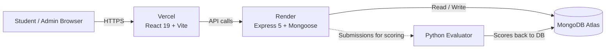

ExamMaster is deployed as a decoupled full-stack application. The React frontend runs on Vercel, the Express backend on Render, and both share a MongoDB Atlas cluster. A Python evaluator handles subjective answer scoring offline or as a side process.

## High-Level Diagram

## Components

<CardGroup cols={2}>
  <Card title="Client (Vercel)" icon="desktop">
    React 19 application built with Vite, Material UI, Redux Toolkit, and React Router. Monitored with Sentry and Vercel Analytics. Served from two URLs: production and staging.
  </Card>

  <Card title="Server (Render)" icon="server">
    Express 5 application on port 3000. Mounts routes at `/api/questions`, `/api/auth`, `/api/submissions`, and `/api/exams`. Uses JWT-based auth middleware and Mongoose models.
  </Card>

  <Card title="Database (MongoDB Atlas)" icon="database">
    Two separate Mongoose connections: one for question/exam data and one for user auth data. Collections include users, exams, objective questions, subjective questions, submissions, and exam assignments.
  </Card>

  <Card title="Evaluator (Python)" icon="code">
    Standalone script using sentence-transformers, spaCy, and language-tool-python to score subjective answers by semantic similarity, keyword coverage, and grammar.
  </Card>
</CardGroup>

## Hosting

| Layer | Platform | URLs |
| --- | --- | --- |
| Frontend | Vercel | Production: `https://online-exam-portal-client.vercel.app` |
|  |  | Staging: `https://online-exam-portal-client-testing.vercel.app` |
| Backend | Render | `https://online-exam-portal-server.onrender.com` |

## Request Flow: Taking an Exam

<Steps>
  <Step title="Login">
    The user submits credentials to `POST /api/auth/login`. The server returns a JWT stored by the client for subsequent requests.
  </Step>
  <Step title="Fetch Assigned Exams">
    The client requests `GET /api/exams/assigned` with the JWT. The server returns only exams assigned to that student.
  </Step>
  <Step title="Start Exam">
    The client loads the exam from `GET /api/questions/all` (filtered client-side or by assignment) and renders objective or subjective questions.
  </Step>
  <Step title="Submit Answers">
    The client posts the submission to `POST /api/submissions/submit`. The server stores answers and returns a submission ID.
  </Step>
  <Step title="Score Objective Questions">
    The server compares objective answers to stored correct options and computes the objective score immediately.
  </Step>
  <Step title="Score Subjective Questions (optional)">
    Subjective answers can be passed to the Python evaluator, which encodes the student answer and model answer, then returns a score based on similarity, keywords, and grammar. The score is persisted back to MongoDB.
  </Step>
  <Step title="View Results">
    The client fetches results via `POST /api/submissions/result/:submissionId` and displays the breakdown.
  </Step>
</Steps>

## CI / CD Overview

Each repository has its own GitHub Actions workflow. The client repo runs tests (commented out in CI), build verification, security audit, and deploys to Vercel staging or production. The server repo runs install, optional lint, security audit, and triggers Render deployments. The main orchestrator repo contains a workflow that checks the latest CI status of both client and server before declaring the full stack healthy.
