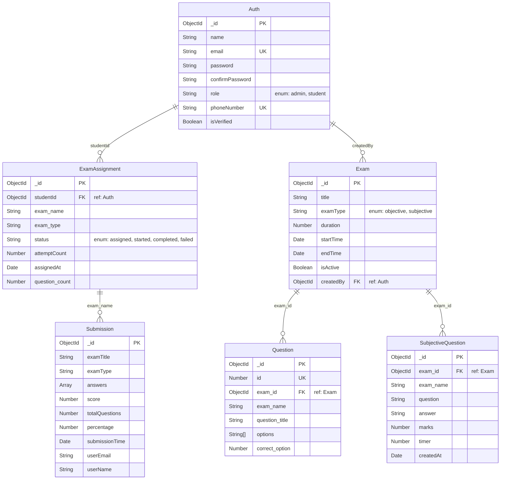

The server uses MongoDB with Mongoose. There are two connection helpers (`connectAuthDB` and `connectQuesDB`) that both point to the same `MONGO_URI`, but the codebase groups auth-related and question-related concerns separately. All collections live in the same database (`test` in the current connection string).

## Collections overview

| Collection | Mongoose Model | Purpose |
| --- | --- | --- |
| `auths` | `Auth` | Registered users |
| `exams` | `Exam` | Exam metadata (title, type, duration, schedule) |
| `examassignments` | `ExamAssignment` | Which student is assigned to which exam |
| `questions` | `Question` | Objective questions (MCQ) |
| `subjectivequestions` | `SubjectiveQuestion` | Subjective questions with reference answers |
| `submissions` | `Submission` | Student exam submissions and scores |

## Entity relationship diagram



## Auth (`Auth.model.js`)

Stores every registered user. Role is derived from the email domain at signup time.

- `name` (String, required)
- `email` (String, required, unique)
- `password` (String, required) -- hashed with bcrypt before storage
- `confirmPassword` (String) -- received at signup but not used after validation
- `role` (String, enum `['admin', 'student']`, default `'student'`)
- `phoneNumber` (String, required, unique)
- `isVerified` (Boolean, default `false`)

<Note>
  The model name is `Auth` but the variable is `User`. The collection name becomes `auths` by Mongoose pluralization rules.
</Note>

## Exam (`Exam.model.js`)

Represents an exam shell. Questions are stored in separate collections.

- `title` (String, required)
- `examType` (String, enum `['objective', 'subjective']`, required)
- `duration` (Number, required) -- minutes
- `startTime` (Date)
- `endTime` (Date)
- `isActive` (Boolean, default `true`)
- `createdBy` (ObjectId, ref `User`)

## ExamAssignment (`ExamAssignment.model.js`)

Links a student to an exam and tracks lifecycle state.

- `studentId` (ObjectId, ref `Auth`, required)
- `exam_name` (String, required)
- `exam_type` (String, required)
- `status` (String, enum `['assigned', 'started', 'completed', 'failed']`, default `'assigned'`)
- `attemptCount` (Number, default `0`)
- `assignedAt` (Date, default `Date.now`)
- `question_count` (Number, default `0`)

<Warning>
  The `startExam` controller enforces `attemptCount < 1`, so each assignment currently allows only one attempt.
</Warning>

## ObjectiveQuestion (`ObjectiveQuestion.model.js`)

MCQ data. The `id` field is a manually assigned numeric identifier (not the MongoDB `_id`).

- `id` (Number, required, unique)
- `exam_id` (ObjectId, ref `Exam`, required)
- `exam_name` (String, required)
- `question_title` (String, required)
- `options` (Array of String, required)
- `correct_option` (Number, required) -- zero-based index into `options`

## SubjectiveQuestion (`SubjectiveQuestion.model.js`)

Short-answer or essay questions with a reference answer and per-question marks.

- `exam_id` (ObjectId, ref `Exam`, required)
- `exam_name` (String, required, trim)
- `question` (String, required, trim)
- `answer` (String, required, trim) -- reference answer for scoring
- `marks` (Number, required, min `0`)
- `timer` (Number, default `null`) -- optional per-question time limit in seconds
- `createdAt` (Date, default `Date.now`)

## Submission (`Submission.model.js`)

A flattened record of a completed exam. The `answers` array shape depends on `examType`.

- `examTitle` (String, required)
- `examType` (String, required)
- `answers` (Array, required)
- `score` (Number, default `0`)
- `totalQuestions` (Number, required)
- `percentage` (Number, default `0`)
- `submissionTime` (Date, default `Date.now`)
- `userEmail` (String, optional)
- `userName` (String, optional)

<Note>
  Submissions are not linked to `Auth` via a formal ref; they store `userEmail` and `userName` as plain strings when available.
</Note>

## Indexes

The `Question.route.js` bootstrap creates two collection indexes on startup for faster lookups by exam name:

```js
await ObjectiveQuestionModel.collection.createIndex({ exam_name: 1 });
await SubjectiveQuestionModel.collection.createIndex({ exam_name: 1 });
```

No other custom indexes are defined in the schema files.
